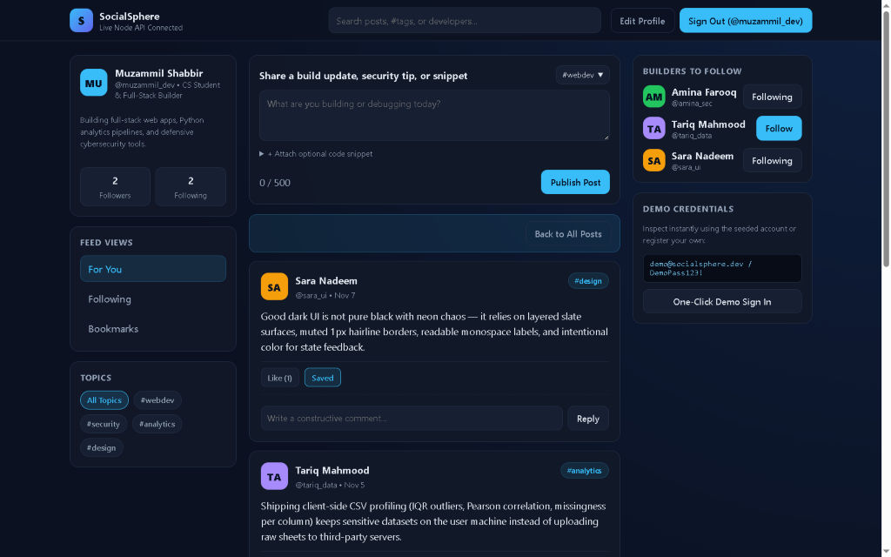

# SocialSphere — Full-Stack Community Platform

> Upgraded from the original `codealpha-socialmedia` internship project into a responsive developer community platform featuring salted `scrypt` authentication, HS256 JWT sessions, ownership-enforced post actions, threaded comments, bookmarks, follow graphs, and XSS-safe DOM rendering.

---

## Live Demo

- **Production URL:** [https://socialsphere-demo.vercel.app/](https://socialsphere-demo.vercel.app/)
- **Mode:** Interactive static/demo frontend deployed on Vercel (full Express backend included in repo for local Node execution).

## Application Preview




## Key Improvements Over Original Codebase

| Area | Original State | Upgraded Solution |
| --- | --- | --- |
| **XSS Hardening** | `frontend/script.js` interpolated raw user post content & comments inside `innerHTML` | Rebuilt rendering layer using `document.createElement` and `.textContent` so user input is never parsed as HTML |
| **Security & Auth** | Exposed `.env` secrets in git history; missing token verification on likes, comments, and deletes | Removed secrets (`.gitignore` + `.env.example`), added Bearer JWT enforcement on write routes, ownership checks (`403` on others' posts), and salted `scrypt` passwords |
| **Rich Social Graph** | Plain text feed only | Added `#topic` tagging, optional code-snippet blocks, Following/Bookmarks tabs, live search, creator profile editing, and persistent follow relationships |
| **Static Fallback** | Broken UI when opened without backend server | Automatically detects `/api/health` and seamlessly runs a local demo store in `localStorage` when deployed as a static demo |

---

## Technology Stack

- **Backend:** Zero-dependency Node.js REST API (`http`, `crypto`, `fs`, `path`)
- **Frontend:** Semantic HTML5, CSS Grid responsive dark theme, Vanilla ES6+
- **Testing:** Node.js built-in test runner (`node --test`)

---

## Setup & Running Locally

```bash
cd backend
cp .env.example .env
node server.js
```

Visit `http://127.0.0.1:5050` in your browser. Click **One-Click Demo Sign In** (`demo@socialsphere.dev` / `DemoPass123!`) or register a new account.

### Run Automated Tests

```bash
node --test tests/socialsphere.test.mjs
```

---

## Security Notice

If cloning an older commit that contained a `.env` file, note that all previously committed credentials should be rotated and treated as compromised. Never commit `.env` files.

---

## Author

**Muzammil Shabbir**  
GitHub: [@Muzammil-s](https://github.com/Muzammil-s) · Email: muzammilw10@gmail.com
